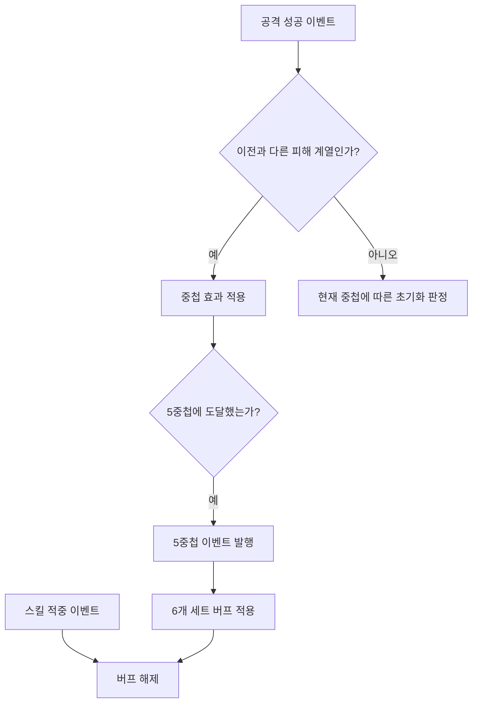

# Eternal Mortis

무기와 룬의 조합에 따라 전투 방식이 달라지는 로그라이트 + 소울라이크 게임입니다. Unreal Engine의 C++와 Blueprint를 사용했으며, GAS를 활용해 다양한 무기의 공격과 스킬, 룬 효과를 구현했습니다.

| 항목 | 내용 |
|---|---|
| 개발 형태 | 4인 팀 캡스톤 프로젝트 |
| 사용 기술 | Unreal Engine / C++ / Blueprint / GAS / Enhanced Input |
| 개발 기간 | 2026.02.07 ~ 2026.07.20 |
| 담당 역할 | 팀장 / GAS 활용 플레이어 조작과 전투 / Subsystem 기반 아이템과 인벤토리 및 성장 시스템 / 상호작용 시스템 / 영구 성장 시스템 |

## 플레이 영상

추가 예정

## 목차

- [담당 범위와 협업](#담당-범위와-협업)
- [핵심 기술](#핵심-기술)
  - [1. Subsystem을 통한 테스트와 협업](#1-subsystem을-통한-테스트와-협업)
    - [공통 함수와 이벤트를 통한 테스트와 협업](#공통-함수와-이벤트를-통한-테스트와-협업)
  - [2. GAS 활용](#2-gas-활용)
    - [2-1. 태그를 활용한 플레이어 동작 제어](#2-1-태그를-활용한-플레이어-동작-제어)
    - [2-2. 다양한 무기와 룬 세트 효과](#2-2-다양한-무기와-룬-세트-효과)
    - [2-3. 피해 계산](#2-3-피해-계산)
  - [3. 전투 경험 개선](#3-전투-경험-개선)
    - [3-1. 락온 카메라와 캐릭터 회전](#3-1-락온-카메라와-캐릭터-회전)
    - [3-2. 입력 버퍼와 공격 구간](#3-2-입력-버퍼와-공격-구간)
- [추가 구현](#추가-구현)
  - [상호작용 대상 선택](#상호작용-대상-선택)
  - [런 상태 관리](#런-상태-관리)
  - [영구 성장과 저장](#영구-성장과-저장)
  - [사망과 부활](#사망과-부활)
  - [무기 연출 연결](#무기-연출-연결)

## 담당 범위와 협업

아이템과 인벤토리 기능은 C++와 BP에서 호출할 수 있는 Subsystem의 함수로 제공했습니다. 팀원들과 공개 함수와 변경 이벤트를 공유해 각자의 기능을 연결했습니다. UI 연동에서는 보유 목록과 장착 슬롯에 필요한 갱신을 구분하도록 Delegate를 조정했습니다.

| 구분 | 담당 내용 |
|---|---|
| Subsystem과 협업 | 아이템 생성과 인벤토리 / 기능 테스트 / C++와 BP 연동용 함수와 Delegate 제공 |
| GAS 활용 | 태그 기반 플레이어 동작 제어 / 무기와 룬 세트 효과 / MMC와 ExecutionCalculation을 활용한 피해 계산 |
| 전투 경험 개선 | 락온 대상 선택과 카메라 구도 / 캐릭터 회전 / 입력 버퍼와 공격 구간 연결 |
| 밸런스 조정 | 엑셀을 활용한 팀 단위 무기 피해량과 몬스터 체력 조정 |
| 추가 구현 | 상호작용 대상 선택 / 런 상태와 영구 성장 / 사망과 부활 흐름 연결 / 전투 상태 감지 |
| 공동 작업 | 초기 UML 설계 / 기반 클래스와 빈 파일 생성 |

프로젝트 초기에는 팀원과 함께 UML을 작성하며 클래스 구조와 역할을 정했습니다. 구조에 맞춰 빈 C++ 파일을 만드는 작업도 나누어 진행했습니다. 이후 맡은 기능을 구현하고, 팀원의 UI와 게임 진행 코드에서 사용할 함수와 이벤트를 연결했습니다. 팀원이 작성한 룬 기획은 GameplayAbility와 GameplayEffect로 구현했습니다.

## 핵심 기술

### 1. Subsystem을 통한 테스트와 협업

아이템 생성과 보유 상태를 `UGameInstanceSubsystem`으로 구성했습니다. 데이터 조회 및 생성은 Database Subsystem이, 보유 및 장착 상태는 Inventory Subsystem이 담당하도록 나눴습니다.

| 구성 | 역할 |
|---|---|
| `MortisWeaponDatabaseSubsystem` | 무기 데이터 조회 / 층과 등급에 따른 무기 선택 |
| `MortisRuneDatabaseSubsystem` | 룬 생성 / 세트 / 등급 / 문양을 지정한 생성 / 관련 데이터 조회 |
| `MortisWeaponInventorySubsystem` | 현재 무기 보관과 변경 |
| `MortisRuneInventorySubsystem` | 보유 룬과 장착 슬롯 / 세트 개수 / 변경 이벤트 관리 |
| `MortisEquipmentComponent` | 장착 상태에 따른 GameplayEffect와 GameplayAbility 적용 및 해제 |

#### 공통 함수와 이벤트를 통한 테스트와 협업

가장 크게 체감한 효과는 디버깅과 기능 테스트가 쉬워졌다는 점입니다. 예를 들어 테스트용 BP에서 필요한 Subsystem을 가져와 생성 / 추가 / 장착 함수를 호출하면서 동작을 확인할 수 있었습니다. 협업에서는 C++와 BP 양쪽에서 공개 함수를 호출하고 변경 이벤트를 받아, 각자 맡은 게임 로직과 UI를 연결했습니다.

[MortisRuneDatabaseSubsystem.h](Source/EternalMortis/Public/System/MortisRuneDatabaseSubsystem.h)의 `GenerateRune()`은 현재 층에 맞는 룬을 생성합니다. 세트와 등급을 지정하는 `GenerateRuneWithTag()`도 제공해 필요한 조건의 룬을 만들 수 있도록 했습니다.

[MortisRuneInventorySubsystem.cpp](Source/EternalMortis/Private/System/MortisRuneInventorySubsystem.cpp)에서는 보유 목록의 추가 / 제거와 장착 슬롯의 추가 / 제거 이벤트를 구분했습니다. UI 담당 팀원과 장착 방식을 협의하고, 각각의 화면 요소가 필요한 변경을 받을 수 있도록 연결했습니다. 구조를 수정한 뒤에는 테스트용 BP에서 다시 동작을 확인했습니다.

생성 규칙이나 장착 효과를 확장할 때도 데이터 조회, 보유 상태, 효과 적용 중 어느 부분을 수정할지 구분할 수 있었습니다. 새 기능을 연결할 때에도 공개 함수와 이벤트를 기준으로 협업했습니다.

**관련 코드 및 Blueprint**

- 무기 생성: [Private/System/MortisWeaponDatabaseSubsystem.cpp](Source/EternalMortis/Private/System/MortisWeaponDatabaseSubsystem.cpp)
- 룬 생성: [Private/System/MortisRuneDatabaseSubsystem.cpp](Source/EternalMortis/Private/System/MortisRuneDatabaseSubsystem.cpp)
- 룬 보유와 장착: [Private/System/MortisRuneInventorySubsystem.cpp](Source/EternalMortis/Private/System/MortisRuneInventorySubsystem.cpp)

---

### 2. GAS 활용

GameplayAbility(GA)로 무기별 공격과 스킬, 룬의 발동 조건을 처리하고, GameplayEffect(GE)로 능력치 변화와 버프를 적용했습니다. 전투 중 발생하는 적중과 회피 이벤트는 GameplayEvent로 전달하고, GameplayTag로 공격 종류와 상태를 구분했습니다.

#### 2-1. 태그를 활용한 플레이어 동작 제어

플레이어의 입력과 상태를 GameplayTag로 구분하고, 입력 태그에 연결된 어빌리티를 실행하도록 구성했습니다. [MortisPlayerAbilitySet.cpp](Source/EternalMortis/Private/AbilitySystem/Data/MortisPlayerAbilitySet.cpp)에서 어빌리티를 부여할 때 입력 태그를 함께 등록하고, [MortisAbilitySystemComponent.cpp](Source/EternalMortis/Private/AbilitySystem/MortisAbilitySystemComponent.cpp)에서 전달받은 태그와 일치하는 어빌리티를 찾아 실행합니다.

| 구분 | 처리 |
|---|---|
| 일반 입력 | 등록된 입력 태그가 일치하는 어빌리티의 활성화 요청 |
| `InputTag.Toggle` 계열 | 어빌리티가 실행 중이면 재입력으로 취소 |
| `InputTag.Hold` 계열 | 입력을 놓으면 해당 어빌리티 취소 |
| 애니메이션 구간 | NotifyState 시작 시 상태 태그 추가 / 종료 시 제거 |

무기 장착 시에도 같은 방식으로 입력 태그와 무기 어빌리티를 등록하고, 해제할 때는 저장한 핸들로 해당 어빌리티를 제거합니다. 무기에 따라 사용할 어빌리티를 교체하면서 입력을 처리하는 공통 흐름을 유지했습니다.

상태 태그는 현재 동작을 다른 기능에서 판단하는 기준으로 사용했습니다. [MortisANS_ApplyTag.cpp](Source/EternalMortis/Private/Animation/NotifyStates/MortisANS_ApplyTag.cpp)는 지정한 애니메이션 구간 동안 태그를 부여하고 종료 시 제거합니다. 락온 코드에서도 현재 상태 태그를 확인해 적을 향하는 회전과 이동 방향 회전을 구분했습니다.

**관련 코드**

- 입력 태그와 어빌리티 등록: [Private/AbilitySystem/Data/MortisPlayerAbilitySet.cpp](Source/EternalMortis/Private/AbilitySystem/Data/MortisPlayerAbilitySet.cpp)
- 입력 종류별 실행과 취소 / 무기 어빌리티 교체: [Private/AbilitySystem/MortisAbilitySystemComponent.cpp](Source/EternalMortis/Private/AbilitySystem/MortisAbilitySystemComponent.cpp)
- 애니메이션 구간의 상태 태그: [Private/Animation/NotifyStates/MortisANS_ApplyTag.cpp](Source/EternalMortis/Private/Animation/NotifyStates/MortisANS_ApplyTag.cpp)

#### 2-2. 다양한 무기와 룬 세트 효과

##### 공통 스킬을 바탕으로 무기별 동작 구현

무기 스킬은 `GA_Player_Skill_Base`에 마나 / 스태미나 비용 처리와 공통 변수, 종료 이벤트 및 입력 버퍼 실행을 모았습니다. 개별 스킬에서는 `DoSkillBehaviour`를 통해 무기별 동작을 구현합니다.

일부 스킬은 근접 공격 몽타주와 회복 동작을 연결하고, 다른 스킬은 락온 대상 유무에 따라 조준 위치를 정해 투사체 세 개를 생성합니다. 무기별 동작과 연출을 구현하면서 비용 처리와 종료 흐름은 공통 스킬 기반을 사용하도록 구성했습니다.

##### 장착 상태에 따른 효과 적용과 해제

룬의 보유 및 장착 데이터는 Inventory Subsystem에서 관리하고, 캐릭터에 효과를 적용하는 작업은 [MortisEquipmentComponent.cpp](Source/EternalMortis/Private/Components/Equipment/MortisEquipmentComponent.cpp)에서 처리했습니다. 장착 이벤트를 받으면 룬의 수치를 `SetByCaller`로 전달해 GameplayEffect를 적용하고, 반환된 핸들을 저장해 해제할 때 사용합니다.

`UpdateRuneSetBonus()`는 현재 장착 개수로 충족하는 세트 단계와 이미 적용된 단계를 비교합니다.

| 장착 상태 변화 | 처리 |
|---|---|
| 새로 충족한 단계 | 해당 단계의 GE와 GA 추가 |
| 더 이상 충족하지 않는 단계 | 저장한 핸들로 효과와 어빌리티 제거 |
| 계속 충족하는 단계 | 기존 적용 상태 유지 |

예를 들어 2 / 4 / 6개 효과가 있는 세트에서 장착 개수가 4개에서 6개로 늘어나면 기존 단계는 유지하고 6개 효과만 추가합니다. 다시 4개가 되면 6개 효과만 제거합니다.

##### 서로 다른 전투 조건을 사용하는 룬 세트

룬 세트는 능력치 보너스와 함께 교대 타격, 연속 적중, 회피 이후 공격, 피해에 비례한 회복 등 서로 다른 조건을 갖도록 구현했습니다. 대표적인 구현 사례는 다음과 같습니다.

| 사례 | 발동 조건과 처리 |
|---|---|
| 흐름의 룬 | 물리와 마법 타격을 번갈아 적중시켜 중첩 / 5중첩 이벤트로 상위 세트 버프 적용 |
| 회피 연계 효과 | 회피 완료와 일반 공격 적중 이벤트를 받아 제한 시간 및 조건을 판정 |
| 적중 누적 효과 | 공격 성공 이벤트로 중첩을 관리하고 조건 충족 시 효과 적용 |
| 피해 기반 회복 효과 | 적중 이벤트의 `EventMagnitude`와 회복 계수로 회복 효과의 수치 계산 |

##### 전투 이벤트를 사용하는 조건부 룬

공격 어빌리티는 적중 이벤트와 공격 종류를 전달하고, 룬별 어빌리티가 자신의 발동 조건을 판정하도록 했습니다.

흐름의 룬은 물리와 마법 타격을 번갈아 적중시키는 조건을 사용합니다. `GA_RuneSet_Flow_4`가 적중 이벤트의 태그를 확인해 중첩을 쌓고, 5중첩에 도달하면 별도 이벤트를 보냅니다. `GA_RuneSet_Flow_6`은 이 이벤트로 버프를 적용하고, 이후 스킬 적중 이벤트를 받으면 해당 버프를 해제합니다.



룬별 조건과 중첩 처리를 해당 어빌리티에 두어, 세트 효과를 추가할 때 기존 공격 흐름에 이벤트 수신 기능을 연결할 수 있도록 했습니다.

**관련 코드 및 Blueprint**

- 효과 적용과 세트 갱신: [Private/Components/Equipment/MortisEquipmentComponent.cpp](Source/EternalMortis/Private/Components/Equipment/MortisEquipmentComponent.cpp)
- 공통 스킬 처리: [Content/Gameplay/Player/Abilities/Action/Skill/GA_Player_Skill_Base.uasset](Content/Gameplay/Player/Abilities/Action/Skill/GA_Player_Skill_Base.uasset)
- 흐름의 룬 중첩: [Content/Gameplay/Player/Abilities/RuneSet/Flow/GA_RuneSet_Flow_4.uasset](Content/Gameplay/Player/Abilities/RuneSet/Flow/GA_RuneSet_Flow_4.uasset)
- 흐름의 룬 버프: [Content/Gameplay/Player/Abilities/RuneSet/Flow/GA_RuneSet_Flow_6.uasset](Content/Gameplay/Player/Abilities/RuneSet/Flow/GA_RuneSet_Flow_6.uasset)


#### 2-3. 피해 계산

피해 계산은 무기와 플레이어 능력치로 정하는 기본 피해량, 공격별 계수와 대상의 저항을 반영하는 최종 피해량으로 나눴습니다. 공식과 초기 수치는 ChatGPT를 활용해 함께 조정했고, 수식이 정리된 뒤에는 엑셀로 만들어 팀원과 공유했습니다. 여러 능력치와 무기 수치를 대입하며 몬스터의 체력과 무기 피해량을 조정했습니다.

##### MMC와 ExecutionCalculation 활용

무기와 능력치로 정해지는 기본 피해량은 MMC에서 계산하고, 적중한 공격의 조건과 대상 저항은 ExecutionCalculation에서 반영하도록 구성했습니다. MMC로 산출한 `BaseDamage`를 ExecutionCalculation의 입력으로 사용해 두 계산을 연결했습니다.

| 계산 | 반영한 값 | 결과 |
|---|---|---|
| MMC | 무기 공격력 / 힘 / 기량 / 지혜 / 무기별 보정 계수 | 기본 피해량인 `BaseDamage` 계산 |
| ExecutionCalculation | `BaseDamage` / 모션 계수 / 공격 종류별 피해 보너스 / 대상 저항 | 최종 피해량을 `IncomingDamage`에 대한 출력 Modifier로 전달 |

무기별 능력치 보정은 기본 피해량 계산에서 처리하고, 개별 공격에서는 모션 계수와 공격 종류를 전달하도록 했습니다. 같은 기본 피해량을 사용하더라도 공격 동작과 피격 대상에 따라 다른 피해량이 적용됩니다.

##### MMC / 기본 피해량

[MortisPlayerBaseDamageCalc.cpp](Source/EternalMortis/Private/AbilitySystem/ExecCalc/MortisPlayerBaseDamageCalc.cpp)는 `GameplayModMagnitudeCalculation`을 사용해 기본 피해량을 계산합니다. 무기 공격력에 힘 / 기량 / 지혜와 무기별 보정 계수를 반영합니다.

$$
f(x)=\frac{100x}{100+x}
$$

$$
B=W\left(1+\frac{c_Sf(S)+c_Df(D)+c_If(I)}{100}\right)
$$

| 기호 | 의미 |
|---|---|
| $B$ | 기본 피해량 |
| $W$ | 무기 공격력 |
| $S / D / I$ | 힘 / 기량 / 지혜 |
| $c_S / c_D / c_I$ | 무기별 능력치 보정 계수 |

양수 능력치에서 $f(x)$는 능력치가 높아질수록 증가 폭이 줄어듭니다. 예를 들어 능력치가 50 / 100 / 150일 때 보정에 사용하는 값은 약 33.3 / 50 / 60입니다. 같은 능력치라도 무기의 보정 계수에 따라 기본 피해량에 미치는 영향이 달라집니다.

##### ExecutionCalculation / 공격과 대상에 따른 최종 피해량

[MortisIncomingDamageExecCalc.cpp](Source/EternalMortis/Private/AbilitySystem/ExecCalc/MortisIncomingDamageExecCalc.cpp)는 `GameplayEffectExecutionCalculation`에서 공격자의 피해 보너스와 대상의 저항을 읽습니다. 공격 종류는 Spec의 태그로 구분하고, 모션 계수는 `SetByCaller`로 받습니다.

$$
D_{final}=\max\left(0,\ B\times M\times(1+A+T+K)\times(1-R_t-R_a)\right)
$$

| 기호 | 의미 |
|---|---|
| $M$ | 공격별 모션 계수 |
| $A$ | 모든 공격 종류에 적용되는 피해 보너스 |
| $T$ | 관통 / 타격 / 참격 / 마법 중 해당 종류의 피해 보너스 |
| $K$ | 스킬 태그가 있을 때 적용되는 피해 보너스 / 없으면 0 |
| $R_t$ | 해당 공격 종류에 대한 저항 |
| $R_a$ | 전체 저항 |

공격 종류에 맞는 보너스와 저항을 선택한 뒤 최종 결과가 음수가 되지 않도록 제한합니다. 계산값이 0보다 크면 `IncomingDamage`에 대한 출력 Modifier를 추가합니다. 이후 [MortisAttributeSet.cpp](Source/EternalMortis/Private/AbilitySystem/Attributes/MortisAttributeSet.cpp)의 `PostGameplayEffectExecute()`에서 이 값을 받아 체력 감소와 UI 알림, 사망 조건을 처리합니다.

이 흐름으로 피해량을 정하는 계산과 계산 결과에 반응하는 체력 / 사망 처리를 연결했습니다. 밸런스를 조정할 때에는 엑셀에서 수치를 비교한 뒤 해당 무기 / 몬스터 데이터에 반영했습니다.

**관련 코드**

- 기본 피해량 계산: [Source/EternalMortis/Private/AbilitySystem/ExecCalc/MortisPlayerBaseDamageCalc.cpp](Source/EternalMortis/Private/AbilitySystem/ExecCalc/MortisPlayerBaseDamageCalc.cpp)
- 적중 시 피해량 계산: [Source/EternalMortis/Private/AbilitySystem/ExecCalc/MortisIncomingDamageExecCalc.cpp](Source/EternalMortis/Private/AbilitySystem/ExecCalc/MortisIncomingDamageExecCalc.cpp)
- 피해 결과와 체력 / 사망 처리 연결: [Source/EternalMortis/Private/AbilitySystem/Attributes/MortisAttributeSet.cpp](Source/EternalMortis/Private/AbilitySystem/Attributes/MortisAttributeSet.cpp)

---

### 3. 전투 경험 개선

#### 3-1. 락온 카메라와 캐릭터 회전

초기 락온은 카메라가 적을 바라보도록 구성했지만, 플레이 테스트에서 적과 대치하는 느낌이 약하고 시야가 불편하다는 피드백을 받았습니다. 이를 개선하기 위해 엘든링 등의 락온 구도를 참고해 플레이어와 적이 함께 보이는 카메라 배치를 비교했습니다.

이후 좌우 Offset을 적용하고 거리에 따라 구도를 조정했습니다. 변경 후 테스트에서는 개선된 시야와 대치 구도에 대해 긍정적인 평가를 받았습니다.

##### 거리와 좌우 위치에 따른 구도 조정

[MortisGA_TargetLock.cpp](Source/EternalMortis/Private/AbilitySystem/Abilities/Player/MortisGA_TargetLock.cpp)의 `UpdateLockOnSpringArmSideOffset()`에서는 플레이어에서 적을 향하는 수평 방향과 카메라의 오른쪽 방향을 내적해 좌우 위치를 판단합니다.

좌우 방향을 전환할 때는 기준값을 두어 중앙 부근의 작은 변화에 곧바로 반응하지 않도록 했습니다. 적까지의 거리를 기준으로 근거리 / 원거리 Offset과 카메라 Yaw 보정값을 보간하고, Spring Arm의 위치와 카메라 회전에도 보간을 적용했습니다. 거리별 줌과 높이 보정도 함께 연결했습니다.

##### 카메라와 캐릭터의 회전 규칙 구분

카메라가 적을 추적하는 동안 캐릭터의 방향은 상태 태그에 따라 처리했습니다. 카메라에 적용한 Pitch와 Yaw 보정은 캐릭터가 바라볼 방향 계산과 분리했습니다.

| 상태 설정 | 캐릭터 처리 |
|---|---|
| 기본 락온 | 적을 향하도록 수평 회전 보간 |
| `CameraOnlyLockTags`에 해당하는 상태 | 적을 향하는 캐릭터 회전을 적용하지 않음 |
| `OrientToMovementTags`에 해당하는 상태 | 이동 방향 회전 활성화 |
| `ForceCharacterRotateToTargetTags`에 해당하는 상태 | 적을 향하는 회전을 우선하고 공격 방향의 Warp Target 갱신 |

강제 회전 상태는 다른 회전 규칙보다 먼저 판정합니다. 이를 통해 카메라의 추적을 유지하면서도 행동별로 필요한 캐릭터 방향을 지정할 수 있도록 했습니다.

##### 대상 선택과 전환

Box Trace로 후보를 수집한 뒤 사망 여부와 시야 조건을 확인합니다. 후보의 우선순위는 시선 방향과 대상 방향의 내적, 대상까지의 거리를 함께 사용합니다. 아래는 `GetTargetScore()`의 점수 계산 부분입니다.

```cpp
const FVector ToTarget = InActor->GetActorLocation() - ViewLocation;
const float Distance = ToTarget.Length();
const float Dot = FVector::DotProduct(ViewRotation.Vector(), ToTarget.GetSafeNormal());

return (Dot * 10000.f) - (Distance * 0.5f);
```

같은 거리에서는 시선 중앙에 가까운 적을, 같은 방향에서는 가까운 적을 우선합니다. 좌우 전환은 카메라의 오른쪽 방향을 기준으로 후보를 나눠 처리합니다. 대상이 사망하거나 시야 / 거리 조건을 벗어나면 다른 후보를 탐색하고, 유지할 대상이 없으면 락온을 종료합니다.

**관련 코드 및 Blueprint**

- 대상 선택과 카메라 / 회전 제어: [Source/EternalMortis/Private/AbilitySystem/Abilities/Player/MortisGA_TargetLock.cpp](Source/EternalMortis/Private/AbilitySystem/Abilities/Player/MortisGA_TargetLock.cpp)
- 카메라 줌과 높이 적용: [Source/EternalMortis/Private/Character/Player/MortisPlayerCharacter.cpp](Source/EternalMortis/Private/Character/Player/MortisPlayerCharacter.cpp)
- 락온 실행과 종료 연결: [Content/Gameplay/Player/Abilities/GA_Player_TargetLock.uasset](Content/Gameplay/Player/Abilities/GA_Player_TargetLock.uasset)

#### 3-2. 입력 버퍼와 공격 구간

공격 동작과 자세를 회복하는 동작을 별도 몽타주로 구성하고, 회복 구간에서 이동하거나 다음 행동으로 이어질 수 있도록 연결했습니다. 다음 행동을 예약하는 입력 버퍼는 AnimNotifyState로 지정한 구간에서 활성화합니다.

[MortisPlayerCharacter.cpp](Source/EternalMortis/Private/Character/Player/MortisPlayerCharacter.cpp)는 허용 구간에 들어온 일반 공격 / 무기 스킬 / 구르기 중 가장 최근 입력 하나를 `BufferedInputTag`에 저장합니다. 공격 어빌리티가 종료된 뒤 `ExecuteBufferedAbility()`에서 저장한 입력을 Ability System Component에 전달하고 버퍼를 비웁니다.

| 단계 | 처리 |
|---|---|
| 입력 허용 구간 진입 | AnimNotifyState에서 버퍼 활성화 |
| 다음 행동 입력 | 최근 입력 태그 저장 |
| 회복 동작 전환 | 회복 몽타주 재생 후 공격 어빌리티 종료 |
| 예약된 행동 실행 | 저장한 입력을 ASC에 전달하고 버퍼 초기화 |
| 회복 중 이동 입력 | 현재 회복 몽타주 중단 |

회복 몽타주는 `bStopWhenAbilityEnds=false`로 재생해 공격 어빌리티가 끝난 뒤에도 동작이 이어지도록 했습니다. 이동 입력에서는 등록된 회복 몽타주를 중단해 이동으로 전환합니다.

**관련 코드 및 Blueprint**

- 입력 저장과 회복 몽타주 제어: [Source/EternalMortis/Private/Character/Player/MortisPlayerCharacter.cpp](Source/EternalMortis/Private/Character/Player/MortisPlayerCharacter.cpp)
- 버퍼 허용 구간: [Source/EternalMortis/Private/Animation/NotifyStates/MortisANS_ActivateInputBuffer.cpp](Source/EternalMortis/Private/Animation/NotifyStates/MortisANS_ActivateInputBuffer.cpp)
- 일반 공격과 회복 동작: [Content/Gameplay/Player/Abilities/Action/NormalAttack/GA_Player_Attack_Base.uasset](Content/Gameplay/Player/Abilities/Action/NormalAttack/GA_Player_Attack_Base.uasset)

## 추가 구현

### 상호작용 대상 선택

플레이어 주변의 오버랩에서 상호작용 가능한 대상을 수집하고, 시선 방향과 거리를 기준으로 우선 대상을 선택했습니다. 여러 대상이 가까이 있을 때에는 시점 기준의 좌우 각도로 정렬해 이전 / 다음 대상을 선택할 수 있도록 했습니다. 선택 표시를 갱신하고 대상에 연결된 어빌리티를 실행하도록 구성했습니다.

### 런 상태 관리

현재 플레이의 골드, 무기, 층과 방 진행 상태를 RunState Subsystem에서 관리했습니다. 골드 획득과 소비는 공통 함수를 거치고 변경 이벤트로 전달하며, 새 런을 시작할 때에는 진행 상태와 부활 비용을 초기화합니다. 게임 진행과 상점 등에서 같은 상태를 조회하고 갱신할 수 있도록 했습니다.

### 영구 성장과 저장

기억파편과 해금한 경험, 룬 슬롯 확장 단계는 MetaProgression Subsystem에서 관리했습니다. 경험 해금이나 슬롯 확장 시 비용과 조건을 확인하고, 변경된 성장 정보는 SaveGame에 저장하도록 연결했습니다. 다음 실행에서 저장된 정보를 불러와 이전의 성장 상태를 이어갈 수 있도록 했습니다.

### 사망과 부활

사망 어빌리티에서 입력을 제한하고, 부활 선택 시 필요한 기억파편을 확인해 비용을 차감하도록 연결했습니다. 부활이 진행되면 상황에 맞는 위치로 이동하고 복구 효과와 입력 재활성화를 적용합니다. 부활 비용은 사용 후 증가하고 새 런에서 초기화되도록 관리했습니다.

### 무기 연출 연결

공격 애니메이션의 지정 구간에서 무기 Trail을 켜고 끄도록 NotifyState를 연결했습니다. 스킬에서는 투사체 생성과 이펙트 재생을 공격 동작에 맞춰 배치하고, 일부 연출은 공격 속도에 따라 재생 속도와 지연 시간을 조정했습니다. 무기별 동작과 연출이 같은 공격 흐름 안에서 실행되도록 구성했습니다.

**관련 코드 및 Blueprint**

- 상호작용 후보 관리: [Source/EternalMortis/Private/Components/Collisions/MortisInteractionComponent.cpp](Source/EternalMortis/Private/Components/Collisions/MortisInteractionComponent.cpp)
- 런 상태: [Source/EternalMortis/Private/System/MortisRunStateSubsystem.cpp](Source/EternalMortis/Private/System/MortisRunStateSubsystem.cpp)
- 영구 성장: [Source/EternalMortis/Private/System/MortisMetaProgressionSubsystem.cpp](Source/EternalMortis/Private/System/MortisMetaProgressionSubsystem.cpp)
- 사망과 부활 연결: [Content/Gameplay/Player/Abilities/GA_Player_Death.uasset](Content/Gameplay/Player/Abilities/GA_Player_Death.uasset)
- 무기 Trail 제어: [Source/EternalMortis/Private/Animation/NotifyStates/MortisANS_WeaponTrail.cpp](Source/EternalMortis/Private/Animation/NotifyStates/MortisANS_WeaponTrail.cpp)
